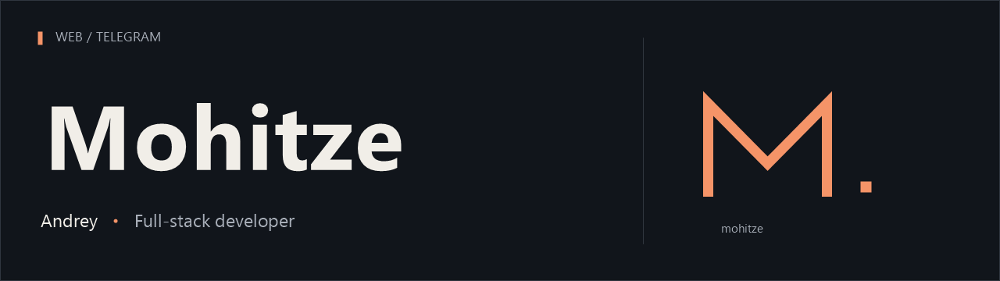

  

  <b>English</b> &nbsp; / &nbsp; <a href="README.ru.md">Русский</a>

  &nbsp; Web development &nbsp; · &nbsp;
  &nbsp; Mini Apps &nbsp; · &nbsp;
  &nbsp; Telegram bots

 

I'm Andrey, a full-stack developer working under the name **Mohitze**.

I build websites, web applications and tools for Telegram. I work on my own services and take on client projects.

**Open to project work.**
