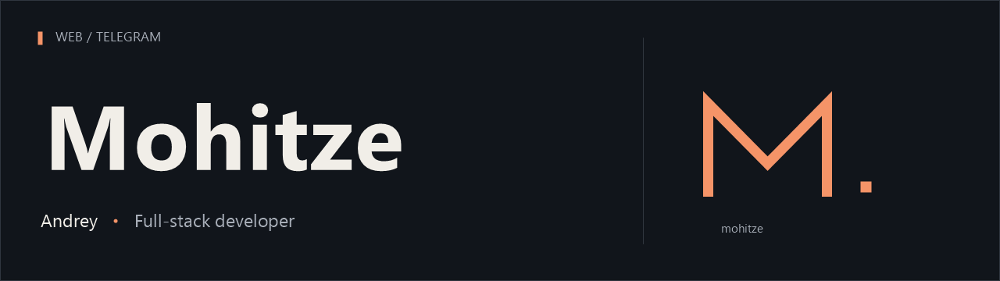

  

  <a href="README.md">English</a> &nbsp; / &nbsp; <b>Русский</b>

  &nbsp; Веб-разработка &nbsp; · &nbsp;
  &nbsp; Mini Apps &nbsp; · &nbsp;
  &nbsp; Telegram-боты

 

Я Андрей, full-stack разработчик. В интернете использую имя **Mohitze**.

Создаю сайты, веб-приложения и инструменты для Telegram. Развиваю собственные сервисы и работаю над клиентскими проектами.

**Открыт к проектной работе.**
